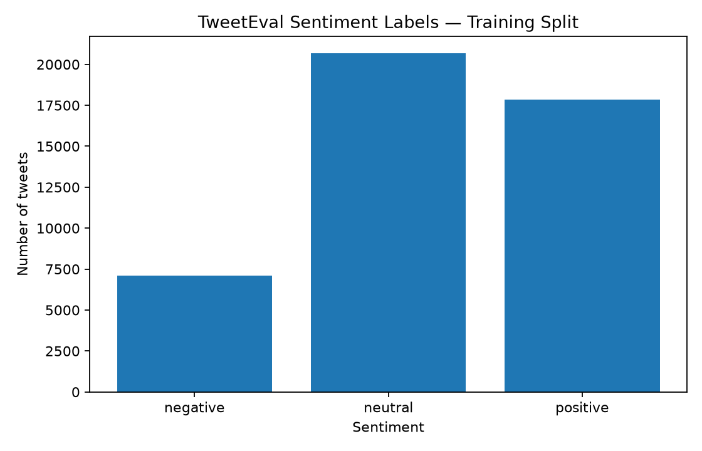
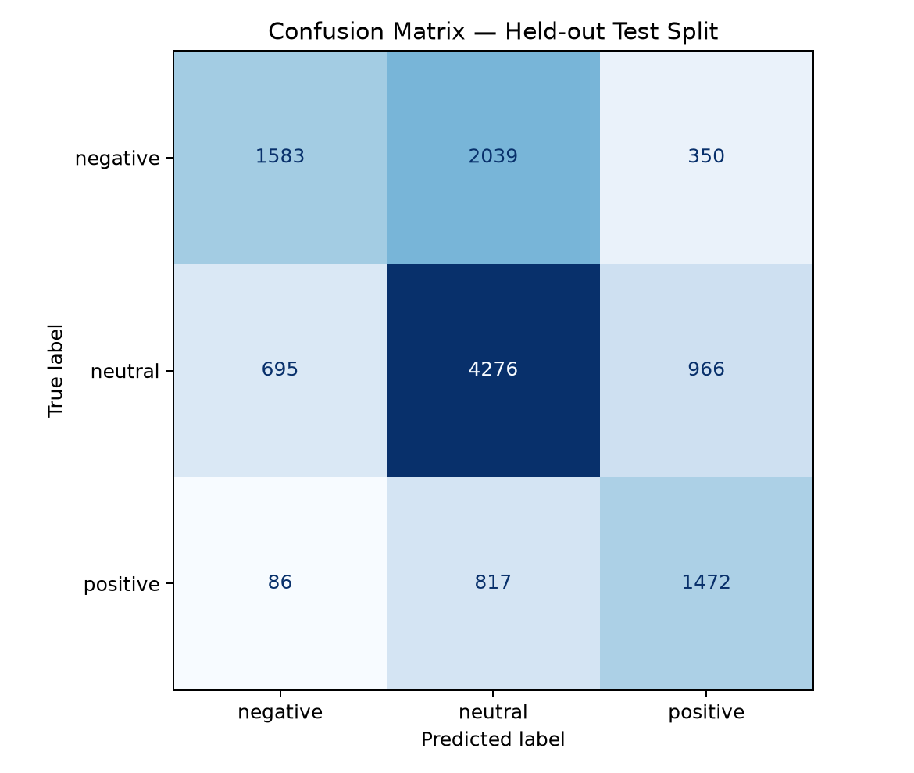

# Sentiment Analysis of Social Media Data

A student-friendly end-to-end project that labels English social-media posts as **negative**, **neutral**, or **positive**. It downloads the TweetEval sentiment dataset, trains a TF-IDF + Logistic Regression baseline, evaluates it on an official held-out test split, saves results, and provides a Streamlit dashboard for single posts or CSV uploads.

## Dataset

- **Name:** TweetEval — sentiment configuration
- **Source:** https://huggingface.co/datasets/cardiffnlp/tweet_eval
- **Task:** 3-class sentiment classification
- **Official splits:** 45,615 train / 2,000 validation / 12,284 test examples
- **Labels:** negative, neutral, positive (the training script reads label names from the dataset metadata)

The dataset is fetched automatically when `python train.py` runs for the first time. An internet connection is required for that initial download. Hugging Face currently lists the dataset license as `unknown`; review the dataset card and applicable terms before redistribution or commercial use. Cite the TweetEval benchmark in academic reports.

## What the project does

1. Downloads the pre-split TweetEval sentiment data.
2. Normalizes URLs, usernames, hashtags, and extra whitespace.
3. Converts text into TF-IDF unigram/bigram features.
4. Trains Logistic Regression using the training split.
5. Checks development performance on the validation split.
6. Refits using train + validation and evaluates once on the held-out test split.
7. Saves a model, metrics, classification reports, a confusion matrix, and per-post predictions.
8. Opens a dashboard to analyze a single post or upload a CSV for bulk predictions.

## Requirements

- Python 3.10 or newer
- Internet connection for the first dataset download and package installation
- About 1 GB of free disk space is recommended for packages and cached dataset/model artifacts; actual usage varies

## Run locally (Windows, macOS, or Linux)

### 1. Download and unzip this project

Open a terminal in the `sentiment_social_media_project` folder.

### 2. Create a virtual environment (recommended)

**Windows PowerShell:**

```powershell
py -m venv .venv
.\.venv\Scripts\Activate.ps1
python -m pip install --upgrade pip
pip install -r requirements.txt
```

**macOS / Linux:**

```bash
python3 -m venv .venv
source .venv/bin/activate
python -m pip install --upgrade pip
pip install -r requirements.txt
```

### 3. Train and evaluate

```bash
python train.py
```

The first run downloads TweetEval. Training prints validation and test metrics. Do not make up or pre-fill your report with an expected accuracy: use the metrics actually printed by your run.

### 4. Start the dashboard

```bash
streamlit run app.py
```

A local URL will be printed in the terminal; open it in a browser. Enter text in **Analyze a post**, or select a CSV under **Analyze a CSV** and select the column containing posts. A useful CSV format is:

```csv
text
"The service was excellent and the staff were kind."
"I am disappointed; my order arrived late."
"The event starts at 7 PM."
```

### 5. Review outputs

After training, these files should appear:

- `artifacts/sentiment_model.joblib` — saved trained model
- `artifacts/label_names.json` — label order
- `reports/metrics.json` — test accuracy, macro F1, split sizes, model name
- `reports/validation_classification_report.txt` — validation precision/recall/F1
- `reports/test_classification_report.txt` — held-out test precision/recall/F1
- `reports/confusion_matrix.png` — which classes the model confuses
- `reports/training_label_distribution.png` — sentiment class counts in training data
- `reports/test_predictions.csv` — actual vs predicted labels and confidence per test example

These outputs are generated when you run the training script. They are not included as fake/precomputed results.

## Google Colab option

1. Upload the unzipped project files to a Colab working directory, or upload the ZIP and extract it.
2. Install packages with `!pip install -r requirements.txt`.
3. Run `!python train.py`.
4. Run `!streamlit run app.py --server.port 8501` if you have a way to expose the Colab port; for the simplest demo, run locally on your computer.

## working

- **Problem:** Manual review of thousands of posts is slow; sentiment classification can summarize broad patterns.
- **Input:** A tweet or a CSV containing many tweets.
- **Preprocessing:** Clean URLs/handles/whitespace while preserving words such as “not”.
- **Feature extraction:** TF-IDF represents words and two-word phrases numerically.
- **Algorithm:** Logistic Regression maps those features to three sentiment classes.
- **Evaluation:** Accuracy is overall correctness; precision and recall explain class-wise behavior; macro F1 averages F1 across classes; the confusion matrix shows which classes are mixed up.
- **Output:** Sentiment label, estimated class probabilities, charts, and a downloadable CSV.

## Important limitations

- The dataset is English Twitter text and is not a representative sample of all social-media users.
- It is a benchmark dataset, not a live stream; the dashboard labels new input but does not collect posts directly from social platforms.
- Sarcasm, slang, context, domain shifts, and mixed sentiment can lead to errors.
- Confidence values are model estimates, not guarantees.
- Check dataset and model licensing/terms before publicly redistributing data or deploying commercially.

## Results and Screenshots




[text](reports/validation_classification_report.txt)